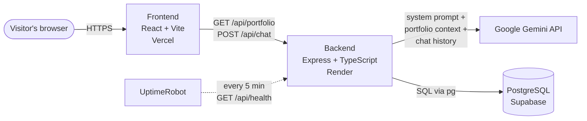
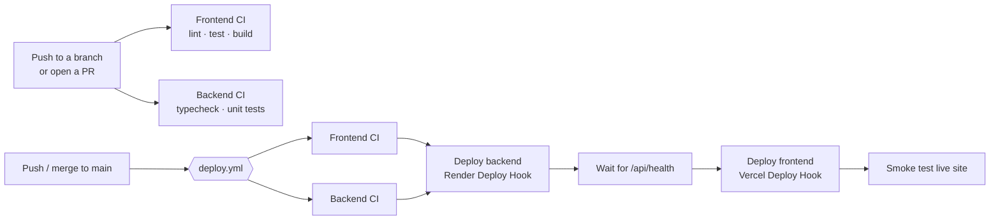

# KUAi — Know Us. Ask AI.

**Team Portfolio AI · AIE312 Final Project**

KUAi is a bilingual (Thai / English) team portfolio with a built-in AI assistant. Visitors browse the team, its members and projects, then ask the AI anything about them. Answers come from Google Gemini, grounded in the team's own portfolio data, and every conversation is stored in PostgreSQL.

| | |
|---|---|
| Live website | https://team-portfolio-ai.vercel.app |
| Backend API | https://kuai-know-us-ask-ai.onrender.com (health check: `/api/health`) |
| Repository | https://github.com/waru1549/KUAi-Know-Us.-Ask-AI. |

## Contents

1. [Architecture](#architecture)
2. [Technology Stack](#technology-stack)
3. [Repository Structure](#repository-structure)
4. [Getting Started (Local)](#getting-started-local)
5. [Environment Variables](#environment-variables)
6. [Testing](#testing)
7. [CI/CD Pipeline](#cicd-pipeline)
8. [Deployment](#deployment)
9. [Security](#security)
10. [Editing Portfolio Data](#editing-portfolio-data)
11. [Team](#team)

## Architecture



How a chat message flows:

1. The browser sends `POST /api/chat` with the message and a `conversationId`.
2. The backend validates the input, applies a per-IP rate limit, and loads the last 40 messages of that conversation from PostgreSQL.
3. It calls Gemini with a system prompt plus the team's portfolio data (**context injection**), so the AI answers only about the team.
4. The question and the answer are saved together in one database transaction, and the answer is returned to the browser.

## Technology Stack

| Layer | Technologies |
|---|---|
| Frontend | React, TypeScript, Vite, Tailwind CSS, React Router, Lucide React |
| Backend | Node.js 22, Express 5, TypeScript (run with `tsx`), `pg` |
| AI | Google Gemini API (`gemini-3.5-flash-lite`) |
| Database | PostgreSQL (hosted on Supabase) |
| Testing | Vitest + React Testing Library (frontend), Node.js test runner (backend) |
| CI/CD | GitHub Actions, Render Deploy Hook, Vercel Deploy Hook |
| Hosting | Vercel (frontend), Render (backend), Supabase (database), UptimeRobot (monitoring) |

## Repository Structure

```text
KUAi-Know-Us.-Ask-AI./
├── .github/workflows/
│   ├── frontend-ci.yml      # lint + test + build the frontend
│   ├── backend-ci.yml       # typecheck + unit tests for the backend
│   └── deploy.yml           # push to main: CI → deploy Render → deploy Vercel → smoke test
├── backend/
│   ├── .env.example         # template for backend secrets (copy to .env)
│   └── src/
│       ├── server.ts        # Express API, Gemini call, system prompt
│       ├── database.ts      # PostgreSQL pool + table creation
│       ├── portfolioData.ts # team data + buildPortfolioContext()
│       ├── guards.ts        # UUID check + rate limiter
│       └── *.test.ts        # backend unit tests
├── frontend/
│   ├── .env.example         # template for frontend settings
│   ├── vercel.json          # SPA rewrites; Git auto-deploy of main is off (the pipeline deploys it)
│   ├── public/images/       # member photos and project screenshots
│   └── src/
│       ├── components/      # layout, portfolio and chat components
│       ├── pages/           # PortfolioPage, ChatPage
│       ├── services/        # chatApi.ts (calls the backend)
│       └── contexts/        # language (TH/EN)
├── docs/                    # API contract, QA test report, team docs
├── .nvmrc                   # Node version used locally, in CI and in production
└── package.json             # npm workspaces: runs frontend + backend together
```

## Getting Started (Local)

### Prerequisites

- Node.js 22 (see `.nvmrc`) and npm
- Git
- A PostgreSQL database: local PostgreSQL, or a free Supabase project
- A Google Gemini API key from https://aistudio.google.com/api-keys

### 1. Clone and install

```bash
git clone https://github.com/waru1549/KUAi-Know-Us.-Ask-AI..git
cd KUAi-Know-Us.-Ask-AI.
npm install
```

`npm install` at the root installs both the frontend and the backend (npm workspaces).

### 2. Create the backend environment file

```bash
cp backend/.env.example backend/.env
# Windows PowerShell: Copy-Item backend/.env.example backend/.env
```

Open `backend/.env` and set at least `GOOGLE_API_KEY` and `DATABASE_URL` (see [Environment Variables](#environment-variables)). The frontend needs no `.env` file for local development.

### 3. Run

```bash
npm run dev
```

| Service | URL |
|---|---|
| Website | http://localhost:5173 |
| Backend | http://localhost:3000 |
| Health check | http://localhost:3000/api/health → `{"status":"ok","database":"ok"}` |

The backend creates its tables (`conversations`, `messages`) on start-up. The Vite dev server forwards `/api` requests to the backend, so no CORS setup is needed locally.

## Environment Variables

### Backend — `backend/.env` locally, Render → Environment in production

| Variable | Required | Example | Purpose |
|---|---|---|---|
| `GOOGLE_API_KEY` | Yes | `AIza…` | Gemini API key. Server-side only. |
| `DATABASE_URL` | Yes | `postgresql://…pooler.supabase.com:5432/postgres?sslmode=require&uselibpqcompat=true` | PostgreSQL connection string. On Supabase use the **Session pooler** URL. |
| `GEMINI_MODEL` | No | `gemini-3.5-flash-lite` | Gemini model name. |
| `CORS_ORIGINS` | Production | `https://team-portfolio-ai.vercel.app` | Comma-separated website origins allowed to call the API, without a trailing `/`. |
| `PORT` | No | `3000` | Set automatically by Render. |
| `NODE_VERSION` | Render only | `22` | Keeps production on the same Node version as CI. |

### Frontend — Vercel → Settings → Environment Variables

| Variable | Required | Example | Purpose |
|---|---|---|---|
| `VITE_API_BASE_URL` | Production | `https://kuai-know-us-ask-ai.onrender.com` | Backend URL baked into the build. Leave empty locally. |
| `API_PROXY_TARGET` | No | `http://localhost:3000` | Local dev proxy target. |

> Anything prefixed `VITE_` is shipped to every visitor's browser. Never put keys or passwords in `VITE_` variables.

## Testing

| Command (from the repository root) | What it runs |
|---|---|
| `npm run test --workspace=frontend` | Vitest + React Testing Library: components, pages, chat API service, language switching |
| `npm run lint --workspace=frontend` | ESLint |
| `npm run build --workspace=frontend` | TypeScript check + production build |
| `npm test --workspace=team-portfolio-ai-backend` | Node.js test runner: UUID validation, per-IP rate limiter, portfolio data and AI context (no placeholder text or secrets reach the AI) |
| `npm run typecheck --workspace=team-portfolio-ai-backend` | Strict TypeScript check of the backend |

Manual system tests and the bugs found during QA are recorded in [`docs/QA_TEST_REPORT.md`](docs/QA_TEST_REPORT.md).

## CI/CD Pipeline



| Workflow | Trigger | Steps |
|---|---|---|
| `frontend-ci.yml` | Pull requests, and pushes to non-main branches that touch `frontend/` | `npm ci` → ESLint → Vitest → production build |
| `backend-ci.yml` | Pull requests, and pushes to non-main branches that touch `backend/` | `npm ci` → TypeScript check → unit tests |
| `deploy.yml` | Every push to `main`, or a manual run | Runs both CI workflows; **only if both pass** it triggers the Render deploy, waits until `/api/health` reports the database OK, triggers the Vercel deploy, then smoke-tests the live site and API |

Production can therefore never receive code that fails linting, tests or the build. Deploy jobs run in the `production` environment and never run in parallel (`concurrency: production-deploy`).

### One-time setup

1. **Render** → service `kuai-know-us-ask-ai` → Settings:
    - **Deploy Hook**: copy the URL.
    - **Auto-Deploy**: set to **Off**, because GitHub Actions deploys instead.
2. **Vercel** → project `team-portfolio-ai` → Settings → Git → **Deploy Hooks**: create a hook for branch `main` and copy the URL. Automatic Git deploys of `main` are turned off in `frontend/vercel.json`; preview deployments for other branches still work.
3. **GitHub** → repository → Settings → Secrets and variables → Actions → **New repository secret**:
    - `RENDER_DEPLOY_HOOK_URL`
    - `VERCEL_DEPLOY_HOOK_URL`
4. Optional repository **variables** `BACKEND_URL` and `FRONTEND_URL`, only if the URLs change.

Deploy hook URLs act like passwords: anyone who has one can start a deploy, so keep them only in GitHub Secrets.

## Deployment

| Part | Host | Settings |
|---|---|---|
| Frontend | Vercel | Root directory `frontend`. Set `VITE_API_BASE_URL`. Deployed by `deploy.yml`. |
| Backend | Render (Web Service, free) | Root directory empty. Build: `npm ci --include=dev`. Start: `npm run start --workspace=team-portfolio-ai-backend`. Health check path `/api/health`. |
| Database | Supabase | Use the **Session pooler** connection string (IPv4). Tables are created by the backend. |
| Monitoring | UptimeRobot | HTTP monitor on `/api/health` every 5 minutes; keeps the free Render service awake and emails an alert if it goes down. |

To redeploy manually: GitHub → Actions → **Deploy** → **Run workflow**.

## Security

- **Secrets stay on the server.** The Gemini key and the database URL live only in `backend/.env` (local) and in Render's environment. The browser talks to our backend, never to Gemini directly.
- **`.env` files are never committed.** `.gitignore` ignores `.env` and `.env.*`; only the `.env.example` templates, with placeholder values, are in Git.
- **Keys go in headers, not URLs.** Gemini is called with the `x-goog-api-key` header, so the key never appears in request logs.
- **Input is validated.** Messages are limited to 2,000 characters and conversation IDs must be UUIDs.
- **SQL injection is prevented** with parameterized queries (`$1`, `$2`).
- **Abuse is limited.** 10 questions per minute per IP, and CORS only allows the production website origins.
- **Prompt rules.** The system prompt restricts the AI to team topics and tells it to ignore attempts to override its instructions.
- **If a key leaks:** delete it in Google AI Studio, create a new one, and update Render and `backend/.env`. No code change is needed.

## Editing Portfolio Data

Team, member and project information lives in `backend/src/portfolioData.ts`. The frontend loads it from `GET /api/portfolio`, and the AI receives it through `buildPortfolioContext()`.

- Images go in `frontend/public/images/projects/…` and are referenced with a leading `/`, e.g. `/images/projects/member-1/member-1.jpg`.
- Text that still starts with `Placeholder:` is never sent to the AI.
- After editing, push to `main`: the pipeline tests and redeploys both sides.

## Team

| Member | Role | Main contribution |
|---|---|---|
| Warunee “Ice” Kludpan | Frontend Developer & UI/UX Designer | Portfolio UI, chat UI, state management |
| Thanakrit “Phum” Archawabool | Backend Developer & Database Engineer | Express API, PostgreSQL, AI context injection |
| Thitiyaphorn “View” Makcha-um | DevOps & QA Engineer | CI/CD, deployment, testing, documentation |

Developed for academic purposes as part of the AIE312 course.
